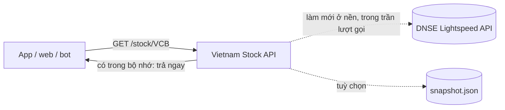

<div align="center">

# 📈 Vietnam Stock API

**API chứng khoán Việt Nam gọn nhẹ, tự host, lấy dữ liệu thẳng từ DNSE bằng khoá của bạn.**

[](https://github.com/tran-minh-khoi/viet-nam-stock/actions/workflows/test.yml)
[](CHANGELOG.md)
[](requirements.txt)
[](docker-compose.yml)
[](LICENSE)

[Bắt đầu nhanh](#-bắt-đầu-nhanh) · [Endpoint](#-endpoint) · [Cấu hình](#%EF%B8%8F-cấu-hình) · [Tài liệu API](docs/API.md) · [Đóng góp](CONTRIBUTING.md)

</div>

---

```bash
$ curl http://localhost:8000/stock/VCB
```
```json
{
  "symbol": "VCB",
  "fullName": "Ngân hàng TMCP Ngoại thương Việt Nam",
  "exchange": "HOSE",
  "currentPrice": 54.3,
  "referencePrice": 53.6,
  "upperPrice": 57.3,
  "lowerPrice": 49.9,
  "change": 0.7,
  "changePercent": 1.31,
  "todayVolume": 1577400,
  "todayDate": "2026-11-10",
  "marketOpen": true
}
```
<sub>Kết quả thật, rút gọn. Giá tính bằng nghìn đồng.</sub>

## ✨ Điểm nổi bật

- **Gọn nhẹ.** Khoảng 1.200 dòng Python với 3 thư viện: `fastapi`, `uvicorn`, `httpx`. Không cần cơ sở dữ liệu hay Redis.
- **Dữ liệu chính chủ.** Lấy thẳng từ [DNSE Lightspeed API](https://developers.dnse.com.vn/docs) bằng khoá của bạn, không qua thư viện trung gian.
- **Luôn trả nhanh.** Dữ liệu giữ trong bộ nhớ, trả trong vài mili giây. Hết hạn thì vẫn trả ngay rồi làm mới ở nền, người dùng không phải chờ nguồn.
- **Bền.** DNSE lỗi, chậm hay trả rỗng thì vẫn giữ bản tốt gần nhất. Bật `SNAPSHOT_FILE` thì khởi động lại vẫn có dữ liệu ngay.
- **Giữ an toàn cho khoá.** Tự đặt trần lượt gọi DNSE mỗi phút, request trùng được gộp lại: 100 người cùng xem một mã chỉ tốn 1 lượt.
- **Dễ dùng.** Có trang thử `/docs`, lỗi trả kèm gợi ý tiếng Việt, chạy được bằng Docker hoặc PM2.

## 🚀 Bắt đầu nhanh

### 1. Lấy khoá DNSE

1. Có tài khoản chứng khoán [DNSE](https://www.dnse.com.vn), đã bật Smart OTP hoặc xác thực email.
2. Đăng nhập trang giao dịch DNSE → **Họ tên → Thông tin tài khoản → LightSpeed API** → **Đăng ký**, chọn cách nhận OTP rồi nhập OTP.
3. Trang hiện **API Key** và **API Secret**. **Chép Secret ngay**, vì DNSE chỉ hiện một lần.

📖 Hướng dẫn gốc của DNSE: [Đăng ký & quản lý](https://developers.dnse.com.vn/docs/guide/intro/register_guide/) · [Xác thực](https://developers.dnse.com.vn/docs/guide/intro/authentication/) · [Hạn mức](https://developers.dnse.com.vn/docs/guide/ratelimits/)

### 2. Chạy

**Docker** (khuyên dùng):

```bash
git clone https://github.com/tran-minh-khoi/viet-nam-stock.git
cd viet-nam-stock
cp .env.example .env      # điền DNSE_API_KEY và DNSE_API_SECRET
docker compose up -d
```

**Python** (3.10 trở lên):

```bash
python3 -m venv venv && ./venv/bin/pip install -r requirements.txt
./start.sh                # hoặc: pm2 start ecosystem.config.js
```

### 3. Thử

Mở **http://localhost:8000/docs** để bấm thử từng endpoint, hoặc:

```bash
curl http://localhost:8000/stock/FPT
curl "http://localhost:8000/stocks?symbols=VCB,FPT,HPG"
curl "http://localhost:8000/index/VNINDEX/history?limit=5"
```

## 📚 Endpoint

| Endpoint | Trả về |
|---|---|
| `GET /stock/{mã}` | Phiên hôm nay, giá đang khớp, tham chiếu/trần/sàn, phiên trước |
| `GET /stock/{mã}/recent?days=7` | N phiên gần nhất (tối đa 30) |
| `GET /stocks?symbols=VCB,FPT` | Nhiều mã một lượt (tối đa 10) |
| `GET /stock/{mã}/history` | Nến `1m` `5m` `15m` `30m` `1H` `1D` `1W` |
| `GET /stock/{mã}/day-range` | Các phiên trong một khoảng ngày |
| `GET /stock/{mã}/quote` · `GET /quotes` | Bảng giá: trần/sàn chính thức, 3 bước giá mua/bán |
| `GET /stock/{mã}/foreign-flow` | Khối ngoại mua/bán theo ngày |
| `GET /index/{chỉ số}/history` | VNINDEX, VN30, VN100, HNXINDEX, HNX30, UPCOMINDEX… |
| `GET /symbols` | Cổ phiếu và chứng chỉ quỹ đang niêm yết |
| `GET /health` · `GET /status` | Tình trạng dịch vụ, hạn mức DNSE còn lại |

Giá tính bằng **nghìn đồng** (`57.2` = 57.200đ), khối lượng tính bằng **cổ phiếu**. Tham số, ví dụ và mã lỗi đầy đủ xem ở [docs/API.md](docs/API.md).

## 🧩 Cách hoạt động



| File | Việc |
|---|---|
| [`dnse.py`](dnse.py) | Client DNSE: ký HMAC-SHA256 từng request, đổi lỗi HTTP thành thông báo dễ hiểu |
| [`sources.py`](sources.py) | Chuyển câu trả lời của DNSE thành JSON của API |
| [`engine.py`](engine.py) | Bộ nhớ đệm `/stock/*`, làm mới ở nền, trần lượt gọi, snapshot |
| [`api.py`](api.py) | Các endpoint FastAPI |

Trong phiên, DNSE chưa có nến ngày của hôm nay (chỉ thêm sau khi phiên kết thúc). Vì vậy phiên hôm nay và giá hiện tại được lấy từ lệnh khớp mới nhất.

## ⚙️ Cấu hình

Mọi cấu hình nằm trong `.env`, có chú thích đầy đủ ở [.env.example](.env.example).

| Biến | Mặc định | Ý nghĩa |
|---|---|---|
| `DNSE_API_KEY`, `DNSE_API_SECRET` | — | Khoá DNSE (**bắt buộc**) |
| `PRIORITY_SYMBOLS` | — | Mã luôn được làm mới ở nền, ví dụ `VCB,FPT` |
| `SHORT_NAMES` | — | Tên hiển thị ngắn, ví dụ `VCB=Vietcombank` |
| `BUDGET_PER_MINUTE` | `60` | Trần lượt gọi DNSE mỗi phút cho cả API |
| `SNAPSHOT_FILE` | — | Lưu dữ liệu tốt gần nhất ra đĩa, ví dụ `state/snapshot.json` |
| `CORS_ORIGINS` | `*` | Website được gọi API từ trình duyệt |
| `ENABLE_DOCS` | `true` | Bật/tắt trang `/docs` |

## ❓ Câu hỏi thường gặp

<details>
<summary><b>Có cần biết lập trình không?</b></summary>

Không. Có Docker là chạy được, rồi mở `/docs` trên trình duyệt để xem dữ liệu.
</details>

<details>
<summary><b>Dữ liệu có trễ không?</b></summary>

Trong giờ giao dịch, mã ưu tiên được làm mới mỗi 20 giây, mã khác mỗi 30 giây. Bảng giá (`/quote`) được cache 15 giây. Đây không phải luồng giá thời gian thực.
</details>

<details>
<summary><b>DNSE báo lỗi chữ ký (OA-400)?</b></summary>

Kiểm tra lại key/secret và đồng hồ của server: DNSE từ chối request lệch quá 1 phút. Trên Linux, bật đồng bộ giờ bằng `timedatectl set-ntp true`.
</details>

<details>
<summary><b>Chạy nhiều tiến trình cho khoẻ hơn được không?</b></summary>

Nên chạy **một** tiến trình, vì bộ nhớ đệm và trần lượt gọi nằm trong tiến trình. Một tiến trình đã đủ phục vụ rất nhiều người, vì phần lớn câu trả lời lấy từ bộ nhớ.
</details>

<details>
<summary><b>Sao không có báo cáo tài chính, hồ sơ doanh nghiệp?</b></summary>

DNSE Lightspeed API không có các dữ liệu này. Dự án chỉ dùng một nguồn để giữ gọn nhẹ.
</details>

## ⚠️ Lưu ý

- **Điều khoản DNSE:** dữ liệu Lightspeed API chỉ được dùng cho mục đích giao dịch của chính chủ tài khoản. Muốn cung cấp dữ liệu cho người khác (website, app công khai…) cần DNSE chấp thuận bằng văn bản ([§2(đ)](https://hdsd.dnse.com.vn/die-u-khoa-n-di-ch-vu-dnse/dieu-khoan-san-pham-dich-vu/dieu-khoan-san-pham-lightspeed-api)). Bạn tự chịu trách nhiệm với khoá của mình.
- **Bảo mật:** giữ `.env` riêng tư (`chmod 600 .env`) và không commit. Lộ khoá thì tạo lại khoá ngay trên trang LightSpeed API. Xem thêm [SECURITY.md](SECURITY.md).
- **Không phải tư vấn đầu tư.** Dữ liệu có thể trễ hoặc sai, hãy đối chiếu trước khi giao dịch.
- Dự án độc lập, không liên kết với DNSE.

## 🤝 Đóng góp

Mọi đóng góp đều được hoan nghênh: báo lỗi, sửa tài liệu, thêm endpoint. Xem [CONTRIBUTING.md](CONTRIBUTING.md).

```bash
pip install -r requirements.txt -r requirements-dev.txt
pytest                    # không cần khoá, không gọi mạng
```

Lịch sử thay đổi: [CHANGELOG.md](CHANGELOG.md).

## 🇬🇧 English

A small self-hosted REST API for Vietnamese stock market data, straight from [DNSE's Lightspeed API](https://developers.dnse.com.vn/docs) with your own key. About 1,200 lines of Python on FastAPI, httpx and uvicorn, with no database. It answers from memory, refreshes in the background and caps calls to DNSE per minute. Get a key ([DNSE guide](https://developers.dnse.com.vn/docs/guide/intro/register_guide/)), put it in `.env`, run `docker compose up -d`, then open http://localhost:8000/docs. Prices are in thousand VND. DNSE's terms only allow the data for the key owner's own trading unless DNSE approves otherwise in writing.

## 📄 Giấy phép

[MIT](LICENSE) © Tran Minh Khoi
